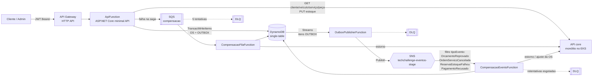
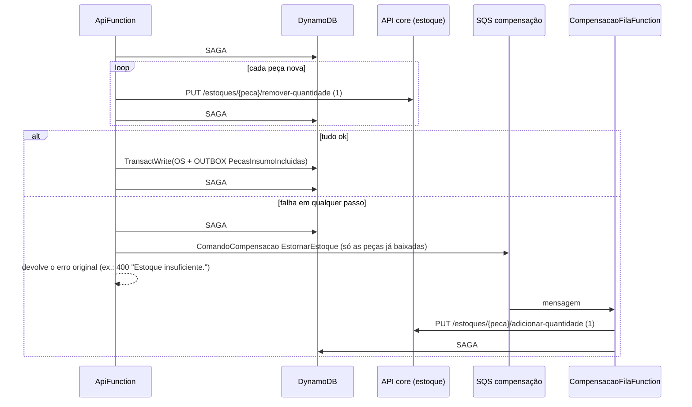

# Lambda — Ordem de Serviço

Migração do domínio **Ordem de Serviço** do monólito (`src/Fiap.TechChallenge.*`) para **AWS Lambda (.NET 8)**, com **DynamoDB**, **API Gateway (HTTP API)**, **SNS**, **SQS** e infraestrutura em **CloudFormation**. O código do monólito não foi alterado.

As rotas, os payloads de request/response, os status HTTP, as mensagens de erro e as regras de autorização são os mesmos do `OrdemServicoController`.

## Arquitetura



Um único pacote, com quatro handlers:

| Função | Gatilho | Handler |
|---|---|---|
| `ApiFunction` | API Gateway HTTP API (payload 2.0) | `OrdemServico.Lambda` |
| `CompensacaoFilaFunction` | SQS `techchallenge-ordem-servico-compensacao-<stage>` | `OrdemServico.Lambda::OrdemServico.Lambda.Functions.CompensacaoFilaFunction::Handle` |
| `CompensacaoEventoFunction` | Assinatura do tópico SNS (filtro por `tipoEvento`) | `OrdemServico.Lambda::OrdemServico.Lambda.Functions.CompensacaoEventoFunction::Handle` |
| `OutboxPublisherFunction` | DynamoDB Streams (filtro: `tipoEntidade = OUTBOX`) | `OrdemServico.Lambda::OrdemServico.Lambda.Functions.OutboxPublisherFunction::Handle` |

## Endpoints (API Gateway → Lambda)

Base: `https://<api-id>.execute-api.<região>.amazonaws.com` (output `ApiUrl` da stack).

| Método | Rota | Auth | Resposta |
|---|---|---|---|
| POST | `/api/v1/ordens-servico` | Administrador | 201 `{ id, clienteNotificado }` |
| GET | `/api/v1/ordens-servico` | Administrador | 200 `OrdemServicoResponse[]` (sem Finalizadas/Entregues, ordenadas por prioridade) |
| GET | `/api/v1/ordens-servico/{id}` | Administrador | 200 `OrdemServicoResponse` |
| GET | `/api/v1/ordens-servico/{id}/progresso` | pública | 200 `OrdemServicoProgressoResponse` |
| POST | `/api/v1/ordens-servico/{id}/servicos` | Administrador | 200 `OrdemServicoResponse` |
| POST | `/api/v1/ordens-servico/{id}/pecas-insumos` | Administrador | 200 `OrdemServicoResponse` (**saga**) |
| PATCH | `/api/v1/ordens-servico/{id}/iniciar-diagnostico` | Administrador | 200 |
| PATCH | `/api/v1/ordens-servico/{id}/finalizar-diagnostico` | Administrador | 200 |
| PATCH | `/api/v1/ordens-servico/{id}/aprovar-orcamento?aprovado=true\|false` | pública | 200 |
| PATCH | `/api/v1/ordens-servico/{id}/confirmar-entrega` | pública | 200 |
| PATCH | `/api/v1/ordens-servico/{id}/servicos/{idServico}/iniciar` | Administrador | 204 |
| PATCH | `/api/v1/ordens-servico/{id}/servicos/{idServico}/finalizar` | Administrador | 204 |
| DELETE | `/api/v1/ordens-servico/{id}/servicos/{idServico}` | Administrador | 204 |
| DELETE | `/api/v1/ordens-servico/{id}/pecas-insumos/{idPecaInsumo}` | Administrador | 204 |
| GET | `/api/v1/ordens-servico/health` | pública | 200 |

Erros seguem o contrato do monólito: `{ "statusCode": 400, "message": "...", "traceId": "..." }`.

O JWT (HMAC-SHA256, issuer `TechChallenge`, audience `techchallenge.com.br`) é validado **dentro da Lambda** com a mesma chave do SSM (`/techchallenge/prod/jwt_secret`). Assim, os tokens emitidos pela API core e pela `lambda-auth-function` continuam valendo. O JWT authorizer nativo do HTTP API não serve aqui porque só aceita chaves assimétricas publicadas via JWKS.

## Saga e compensação

### 1. Saga orquestrada: inclusão de peças/insumos (compensação por **fila**)

No monólito, `IncluirPecaInsumo` baixava o estoque e gravava a OS na mesma transação do EF Core. Agora o estoque fica em outro serviço, então o fluxo virou uma saga:



A fila tem 5 tentativas antes de ir para a DLQ e usa partial batch response. Ela também aceita comandos de outros serviços:

```json
{
  "idCompensacao": "id-unico-para-idempotencia",
  "tipo": "EstornarEstoque | RemoverPecaInsumo | CancelarOrdemServico",
  "idOrdemServico": "guid",
  "pecasInsumosIds": ["guid"],
  "motivo": "texto",
  "idSaga": "guid (opcional)"
}
```

### 2. Saga coreografada: compensação por **evento** (SNS)

Tudo passa pelo tópico `techchallenge-eventos-<stage>` (output `EventosTopicArn`). A mensagem é o JSON do evento, e o tipo vai nos atributos de mensagem:

| Atributo | Exemplo | Obrigatório |
|---|---|---|
| `tipoEvento` | `PagamentoRecusado` | Sim. O filtro da assinatura usa este atributo; sem ele a mensagem não é entregue |
| `origem` | `techchallenge.pagamento` | Não. Vai para o log e para `CompensacaoExecutada` |
| `idOrdemServico` | guid | Não. Publicado nos nossos eventos, para filtro de quem assina |

| `tipoEvento` | Publicado por | Compensação |
|---|---|---|
| `OrcamentoReprovado` | Ordem de Serviço | Estorna o estoque das peças da OS |
| `OrdemServicoCancelada` | Ordem de Serviço | Estorna o estoque das peças da OS |
| `ReservaEstoqueFalhou` | Estoque | Remove a peça da OS e recalcula o orçamento |
| `PagamentoRecusado` | Pagamento | Cancela a OS, que publica `OrdemServicoCancelada` e com isso estorna o estoque |

Exemplos de mensagem aceitos (de outros serviços):

```json
{ "idOrdemServico": "guid", "idPecaInsumo": "guid", "motivo": "Estoque insuficiente." }
{ "idOrdemServico": "guid", "motivo": "Cartão recusado" }
```

Outros serviços assinam o mesmo tópico com o próprio filtro de `tipoEvento`. O SNS não guarda histórico: quem precisa reprocessar eventos deve assinar com uma fila SQS.

### Garantias

- **Transactional outbox**: a OS e os seus eventos são gravados na mesma `TransactWriteItems`. O Streams entrega os itens `OUTBOX#` ao publicador, que repete a tentativa e, se não conseguir, manda para a DLQ. Estado e evento nunca divergem.
- **Idempotência**: cada compensação tem um `idCompensacao` (`saga-<id>`, `evt-<idEvento>` nos nossos eventos, `evt-<MessageId do SNS>` nos externos, ou o id enviado na fila). O registro `COMPENSACAO#id` guarda as peças já estornadas, então uma mensagem reentregue não devolve a mesma peça duas vezes.
- **Concorrência otimista**: o atributo `versao` é verificado na gravação. Se houver conflito, a API responde 409.
- **Observabilidade**: logs JSON com `correlation_id` (header `X-Correlation-ID`, que também é repassado à API core), X-Ray ativo, alarmes nas 3 DLQs e alarme de 5xx na API.

## Modelo DynamoDB (single-table)

| PK | SK | Conteúdo |
|---|---|---|
| `OS#{id}` | `METADATA` | Agregado completo (`dados`), `versao`, `GSI1PK = ORDEM_SERVICO#ATIVA \| #ENCERRADA`, `GSI1SK = dataAbertura#id` |
| `OS#{id}` | `SAGA#{idSaga}` | Log da saga (peças solicitadas/reservadas, status). TTL de 30 dias |
| `OUTBOX#{idEvento}` | `OUTBOX` | Evento pendente (`tipoEvento`, `payload`). TTL de 1 dia |
| `COMPENSACAO#{id}` | `COMPENSACAO` | Controle de idempotência. TTL de 30 dias |

O `GET /ordens-servico` consulta o GSI1 com `ORDEM_SERVICO#ATIVA`, o mesmo filtro do monólito (exclui Finalizada/Entregue).

## Deploy

Pré-requisitos: AWS CLI autenticada, .NET 8 SDK e o parâmetro SSM da chave JWT já existente (é o mesmo do EKS).

```bash
cd lambda-ordem-servico
./scripts/deploy.sh                                  # descobre o ALB da API core automaticamente
CORE_API_BASE_URL=http://meu-alb... ./scripts/deploy.sh
RESEND_SSM_PARAM=/techchallenge/prod/resend_api_key ./scripts/deploy.sh
```

O script roda os testes, faz `dotnet publish` para `linux-arm64`, envia o zip ao S3 e aplica `infra/template.yaml` via `aws cloudformation deploy`.

Testar as compensações manualmente:

```bash
# por fila
aws sqs send-message --queue-url <CompensacaoQueueUrl> --message-body file://events/sqs-estornar-estoque.json
# por evento
aws sns publish --topic-arn <EventosTopicArn> --cli-input-json file://events/sns-reserva-estoque-falhou.json
aws sns publish --topic-arn <EventosTopicArn> --cli-input-json file://events/sns-pagamento-recusado.json
```

Desenvolvimento local:

```bash
dotnet test OrdemServico.Lambda.sln
```

## Diferenças em relação ao monólito

| Ponto | Monólito | Lambda |
|---|---|---|
| Baixa de estoque em `pecas-insumos` | Mesma transação do EF Core | Saga com compensação (estorno via SQS) |
| Orçamento reprovado | Só muda o status | Muda o status **e** estorna o estoque das peças (evento `OrcamentoReprovado`) |
| Status `ORCAMENTO_APROVADO/REPROVADO` | Não estão no `DatabaseSeed` (a aprovação falharia com "status não encontrado") | Catálogo em código com os mesmos Ids do seed, mais esses dois |
| Cliente, serviço e peça | Join no PostgreSQL | Lidos da API core e guardados como snapshot na OS (nome, valor, tempo estimado, e-mail) |
| OS cancelada ou com orçamento reprovado | Status não existe no fluxo | Não aceita incluir/remover itens nem iniciar/finalizar serviços (400) |
| Conflito de gravação concorrente | Último a gravar vence | 409 (concorrência otimista) |
| Destinatário do e-mail | Fixo no código | E-mail do cliente, ou `EMAIL_DESTINO_OVERRIDE` |
| Métricas Prometheus | `IObservabilityMetrics` | Logs estruturados (`Etapa ... concluída em N segundos`) consultáveis no CloudWatch Logs Insights |

Continua igual ao monólito: remover uma peça da OS **não** devolve o estoque. Também não foi migrado o `GET /api/v1/servicos/metricas-tempo`: ele pertence ao domínio de Serviço e ainda lê os itens de OS do PostgreSQL.
